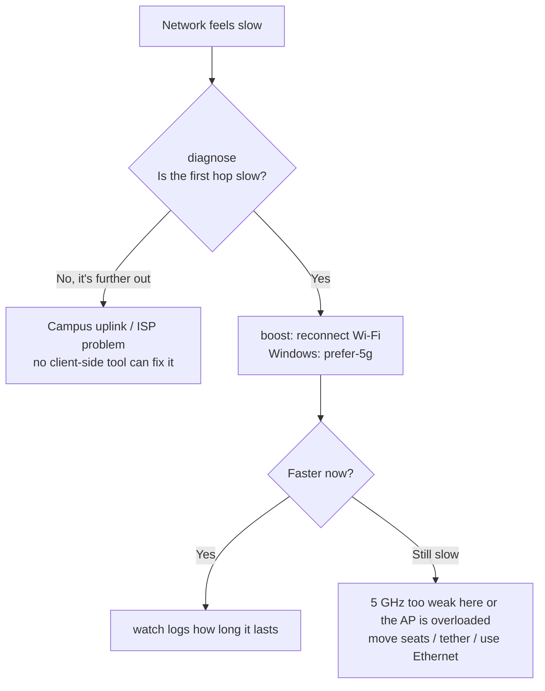

<div align="center">

# eduroam-boost

**Campus Wi-Fi crawling? Measure where it's slow, then fix the part that's actually broken.**

[](https://github.com/LucasYanzy/eduroam-boost/actions/workflows/test.yml)


[简体中文](README.md) | **English**

</div>

On big campus networks like eduroam, devices often get stuck on a crowded or weak 2.4 GHz access point. The **very first hop, from your laptop to the access point**, can then take hundreds of milliseconds, and no amount of bandwidth further along fixes that. VPNs and "gaming accelerators" optimise the route *after* the access point, so they can't help here.

eduroam-boost does three things:

- 🔍 **Measure**: band, signal, first-hop latency and loss; is the bottleneck the Wi-Fi hop or the network upstream?
- ⚡ **Fix**: reconnect to pick a better access point, but only when the connection is actually slow (on Windows it can also make the adapter prefer 5 GHz permanently)
- 📊 **Verify**: log before/after numbers, success rate, and how long each fix lasted, and say so plainly when it didn't help

```console
$ eduroam-boost
Band     2.4GHz   6 (2GHz, 20MHz)
Signal   -73 dBm (noise -94 dBm)
Rate     24 Mbps
Router 546 ms, loss 0%
Faster same-type networks nearby: 157 (5GHz, 40MHz)

Diagnosis: slow — first hop averages 546 ms (>100); on 2.4 GHz while a 5/6 GHz network of the same type is nearby
Try:  eduroam-boost boost
```

<sub>↑ Numbers from a real measurement: a MacBook Pro on a university eduroam network, November 2026.</sub>

## Contents

- [Supported platforms](#supported-platforms)
- [Install](#install)
- [Usage](#usage)
- [How it works](#how-it-works)
- [Real-world results](#real-world-results)
- [iPhone / iPad](#iphone--ipad)
- [Android](#android)
- [Privacy & security](#privacy--security)
- [FAQ](#faq)
- [Uninstall](#uninstall)
- [Contributing](#contributing)

## Supported platforms

| Platform | What it can do | Install | Status |
|---|---|---|---|
| **macOS** | Diagnose · reconnect to a better AP · background watcher · effectiveness stats | One command | ✅ In daily use on real hardware |
| **Windows** | All of the above, plus **make the adapter prefer 5 GHz permanently** | One command | 🧪 Experimental: automated tests pass, not yet verified on real hardware |
| **iPhone / iPad** | One-tap Wi-Fi off/on (Shortcut) | Import a Shortcut | 🧪 Experimental: not yet verified on a device |
| **Android** | Apps can't toggle Wi-Fi on modern Android | Manual steps | 📄 Instructions only |

## Install

### macOS

Open Terminal and paste:

```bash
curl -fsSL https://raw.githubusercontent.com/LucasYanzy/eduroam-boost/main/install.sh | bash
```

The installer asks whether to start a **background watcher** at login:

| Answer | What happens |
|---|---|
| `n` (default) | Command only; run it when you need it |
| `y` notify | Checks every 30 s; after 3 slow checks in a row (~1.5 min) you get a notification |
| `a` auto | Same, but it reconnects for you; Wi-Fi drops for a few seconds each time, at most once every 5 minutes |

To skip the question, pass a flag: `… | bash -s -- --watch`, `--watch-auto` or `--no-watch`.

> Requires Python 3.8+, which macOS usually has. If it's missing, run `xcode-select --install` first.
> No admin rights needed; it uses only the Python standard library and built-in macOS tools. The command goes into `~/.local/bin`, and the installer tells you if that needs adding to your PATH.

### Windows (experimental)

Open PowerShell and paste:

```powershell
irm https://raw.githubusercontent.com/LucasYanzy/eduroam-boost/main/windows/install.ps1 | iex
```

The installer asks two things: whether to start a background watcher at logon, and whether to make your Wi-Fi adapter **prefer 5 GHz** right away (one admin prompt). Open a new terminal afterwards and `eduroam-boost` is ready.

## Usage

| Command | What it does |
|---|---|
| `eduroam-boost` | Current status with a diagnosis (same as `status`) |
| `eduroam-boost diagnose` | 20-second side-by-side test: is the Wi-Fi hop slow, or the campus uplink / ISP? |
| `eduroam-boost boost` | Reconnect Wi-Fi up to 3 times, re-measuring each time, and stop once it's fast. Does nothing if the connection isn't slow (`--force` to override, `--tries N` to change the count) |
| `eduroam-boost watch` | Keep watching in the foreground; `--auto` to reconnect automatically, `--interval SECONDS` to change the check interval |
| `eduroam-boost report` | Stats for the last 24 h (`--hours N`): time per band, latency, every boost's before/after, and **how long the improvement lasted** |
| `eduroam-boost prefer-5g` | Windows only: set the driver's *Preferred Band* to 5 GHz, persists across reboots; `-Undo` restores the default |

Suggested flow:

1. Feels slow → run `eduroam-boost diagnose` to see whether Wi-Fi is the problem
2. It is → `eduroam-boost boost` (on Windows, try `prefer-5g` first)
3. After a few days → `eduroam-boost report` to see whether it actually helped

Output follows your system language (Chinese or English); force one with `EDUROAM_BOOST_LANG=en` or `=zh`. Logs live in `~/Library/Logs/eduroam-boost/` on macOS and `%LOCALAPPDATA%\eduroam-boost\` on Windows.

## How it works



**Why it happens:** a campus access point usually broadcasts on both 2.4 GHz and 5 GHz (newer ones on 6 GHz too). 2.4 GHz goes through walls better but has few channels and gets crowded; 5/6 GHz is much faster. Devices tend to stay on whatever band they joined first (the "sticky client" problem), even when a much better 5 GHz signal is right there.

**How it decides:** it reads the system's Wi-Fi details (band, signal, whether a 5/6 GHz network of the same type is visible) and pings the default gateway to measure first-hop latency and loss. Only **measured symptoms** count as slow: latency over 100 ms or loss over 10%. Being on 2.4 GHz next to a 5 GHz network is only a hint, because a weak 5 GHz signal can be worse than a decent 2.4 GHz one (that happened in the [real-world test](#real-world-results)).

**How it fixes:** macOS and iOS don't let you choose a band or a specific access point, but turning Wi-Fi off and on forces a fresh scan, which often lands on a better one. On Windows, most Wi-Fi drivers have a *Preferred Band* setting; setting it to 5 GHz is more thorough than reconnecting repeatedly.

**How it verifies:** every boost records before/after numbers, and the watcher keeps sampling, so `report` can compute the success rate, latency per band, and how long after each boost the connection got slow again.

## Real-world results

A MacBook Pro on a US university's eduroam network, same spot, November 2026:

| Time | Band / signal | First hop (avg / max) | Loss |
|---|---|---|---|
| 13:28 | 2.4 GHz channel 6, -70 dBm | 72 ms / 230 ms | 0–10% |
| 14:05 | 2.4 GHz channel 6, -73 dBm | **546 ms / 1544 ms** | 0% |
| 14:14 (before boost) | 2.4 GHz, -69 dBm | 25 ms | 0% |
| After 3 reconnects | still 2.4 GHz every time, -68 dBm | 10–43 ms | 0–10% |

To be honest about it:

- **Boost could not move this spot to 5 GHz.** A same-type 5 GHz network was visible, but the Mac picked 2.4 GHz on all three reconnects. The 5 GHz signal there is weaker, so the Mac made the right call.
- **The same access point swung from 10 ms to 1.5 s over the day.** That's mostly how crowded the AP was, not the band.
- **This test improved the tool.** An early version reconnected whenever it saw "2.4 GHz with 5 GHz nearby", which meant three pointless Wi-Fi drops here. It now acts on latency and loss only.

Longer-term watcher data (how long a fix lasts) will be added over time. You're welcome to share your campus's `eduroam-boost report` output in [Issues](https://github.com/LucasYanzy/eduroam-boost/issues).

## iPhone / iPad

iOS doesn't let any app choose a band or read access-point details, so the phone can only do one thing: toggle Wi-Fi with one tap so it picks an access point again.

1. In Safari on your iPhone, open **[eduroam-Boost.shortcut](https://github.com/LucasYanzy/eduroam-boost/raw/main/ios/eduroam-Boost.shortcut)**, open the download with Shortcuts, and tap **Add Shortcut**.
2. Run it whenever things feel slow: Wi-Fi off → wait 3 s → on → notification.

Tip: trigger it with a double tap on the back of the phone: *Settings → Accessibility → Touch → Back Tap → Double Tap → eduroam Boost*. You can also add it to the Home Screen or Control Center.

**Import doesn't work?** Building it yourself takes a minute: new shortcut → add **Set Wi-Fi** = **Off** → add **Wait** 3 seconds → add **Set Wi-Fi** = **On**.

> If your Mac and iPhone share an Apple ID with Shortcuts enabled in iCloud, adding it on the Mac syncs it to the phone.

## Android

Since Android 10, regular apps can neither toggle Wi-Fi nor choose an access point, so there's no one-tap tool. Manual options:

- **Toggle Wi-Fi**: pull down Quick Settings and turn Wi-Fi off and on, same effect as the iPhone Shortcut.
- **Prefer 5 GHz**: some phones (e.g. Samsung, Xiaomi) have a band selection or "prefer 5 GHz" option under Wi-Fi → Advanced.
- **ADB** (for developers):
  ```bash
  adb shell cmd wifi set-wifi-enabled disabled && sleep 3 && adb shell cmd wifi set-wifi-enabled enabled
  ```

## Privacy & security

- **No data collection, no uploads.** Everything is stored only on your own machine.
- **Very little network traffic**: pings to your default gateway; `diagnose` also pings `1.1.1.1`.
- **No network names needed.** macOS hides SSIDs without Location permission, and this tool doesn't use them.
- **No changes to your network configuration.** On macOS it only turns Wi-Fi off and on; on Windows the adapter's *Preferred Band* changes only when you run `prefer-5g`, and `-Undo` restores it.
- **Small enough to read.** The tool is one Python file and one PowerShell file; feel free to read them before installing.

## FAQ

<details>
<summary><b>Will reconnecting interrupt downloads or video calls?</b></summary>

Yes, Wi-Fi drops for a few seconds. That's why boost only acts when the connection is actually slow, and the background watcher only notifies by default.
</details>

<details>
<summary><b>Boost tried 3 times and I'm still on 2.4 GHz. Is it broken?</b></summary>

No. It means the 5 GHz signal at your spot is weaker than 2.4 GHz, so your device chose correctly. Software can't do more here: move closer to an access point, tether to your phone, or use Ethernet.
</details>

<details>
<summary><b>diagnose says the campus uplink is slow. Now what?</b></summary>

Then it isn't your device or the Wi-Fi, and no tool on your computer can help. Wait for the peak to pass, or use a different network.
</details>

<details>
<summary><b>Why not connect to a specific BSSID (one exact access point)?</b></summary>

macOS and iOS don't allow command-line tools to do that (it needs Location permission and private APIs). This tool sticks to public, stable system features so OS updates are less likely to break it.
</details>

<details>
<summary><b>Does it work outside eduroam?</b></summary>

Yes. It works on any Wi-Fi that offers both 2.4 GHz and 5/6 GHz, such as other campus or office networks.
</details>

## Uninstall

macOS (add `-s -- --purge` to also delete the logs):

```bash
curl -fsSL https://raw.githubusercontent.com/LucasYanzy/eduroam-boost/main/uninstall.sh | bash
```

Windows (if you used `prefer-5g`, run `eduroam-boost prefer-5g -Undo` first to restore the adapter setting):

```powershell
irm https://raw.githubusercontent.com/LucasYanzy/eduroam-boost/main/windows/uninstall.ps1 | iex
```

## Contributing

```
eduroam_boost.py        macOS CLI (standard library only)
install.sh / uninstall.sh
windows/                PowerShell port, installer/uninstaller, Pester tests
ios/                    iPhone Shortcut and the script that builds it
tests/                  macOS unit and installer tests
```

```bash
python3 -m unittest discover -s tests -v                  # macOS: unit + install/uninstall tests (all in temp dirs)
pwsh -c "Invoke-Pester windows/tests -Output Detailed"    # Windows: parser tests
python3 ios/build_shortcut.py                             # rebuild and sign the Shortcut (needs macOS)
```

CI runs on macOS, Windows and Linux (shellcheck) for every push. Contributions especially welcome:

- **Windows results on real hardware**, especially how `prefer-5g` behaves on different adapters
- **`netsh` output from non-English Windows**, added to `windows/tests/fixtures/`
- **Measurements from your campus** (`eduroam-boost report` output)

## License

[MIT](LICENSE)
