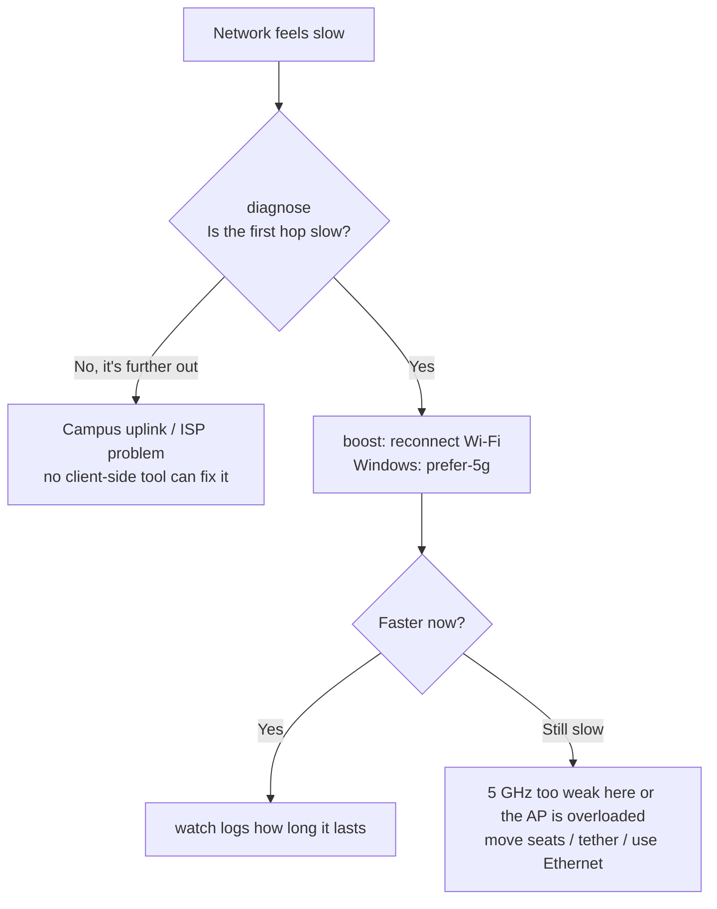

<div align="center">


# eduroam-boost

**Campus Wi-Fi crawling? Measure where it's slow, then fix the part that's actually broken.**

[](https://github.com/LucasYanzy/eduroam-boost/actions/workflows/test.yml)


[简体中文](README.md) | **English**

</div>

On big campus networks like eduroam, devices often get stuck on a crowded or weak 2.4 GHz access point. The **very first hop, from your laptop to the access point**, can then take hundreds of milliseconds, and no amount of bandwidth further along fixes that. VPNs and "gaming accelerators" optimise the route *after* the access point, so they can't help here.

eduroam-boost does three things:

<table>
<tr>
<td width="33%" valign="top">
<br>
<b>Measure</b><br>
<sub>Band, signal, first-hop latency and loss, plus every nearby AP's <b>channel utilization and client count</b> (which macOS normally hides)</sub>
</td>
<td width="33%" valign="top">
<br>
<b>Fix</b><br>
<sub>A seat finder shows the live 5 GHz vs 2.4 GHz signal gap so you can find a spot where macOS picks 5 GHz on its own; reconnects only when that can work</sub>
</td>
<td width="33%" valign="top">
<br>
<b>Verify</b><br>
<sub>Log before/after numbers, success rate and how long each fix lasted, and say so plainly when it didn't help</sub>
</td>
</tr>
</table>

```console
$ eduroam-boost
Band     2.4GHz   6 (2GHz, 20MHz)
Signal   -73 dBm (noise -94 dBm)
Rate     24 Mbps
Router 546 ms, loss 0%
Faster same-type networks nearby: 157 (5GHz, 40MHz)

Diagnosis: slow — first hop averages 546 ms (>100); on 2.4 GHz while a 5/6 GHz network of the same type is nearby
Try:  eduroam-boost boost
```

<sub>↑ Numbers from a real measurement: a MacBook Pro on a university eduroam network, November 2026.</sub>

## Contents

- [Supported platforms](#supported-platforms)
- [Install](#install)
- [Usage](#usage)
- [How it works](#how-it-works)
- [Real-world results](#real-world-results)
- [iPhone / iPad](#iphone--ipad)
- [Android](#android)
- [Privacy & security](#privacy--security)
- [FAQ](#faq)
- [Uninstall](#uninstall)
- [Contributing](#contributing)

## Supported platforms

| Platform | What it can do | Install | Status |
|---|---|---|---|
| **macOS** | Diagnose · per-AP congestion survey · seat finder · reconnect · background watcher · effectiveness stats | One command |  In daily use on real hardware |
| **Windows** | Diagnose · reconnect · background watcher · effectiveness stats, plus **make the adapter prefer 5 GHz permanently** | One command |  Automated tests pass, not yet verified on real hardware |
| **iPhone / iPad** | One-tap Wi-Fi off/on (Shortcut) | Import a Shortcut |  Not yet verified on a device |
| **Android** | Apps can't toggle Wi-Fi on modern Android | Manual steps |  |

## Install

### macOS

Open Terminal and paste:

```bash
curl -fsSL https://raw.githubusercontent.com/LucasYanzy/eduroam-boost/main/install.sh | bash
```

The installer asks whether to start a **background watcher** at login:

| Answer | What happens |
|---|---|
| `n` (default) | Command only; run it when you need it |
| `y` notify | Checks every 30 s; after 3 slow checks in a row (~1.5 min) you get a notification |
| `a` auto | Same, but it reconnects for you; Wi-Fi drops for a few seconds each time, at most once every 5 minutes |

To skip the question, pass a flag: `… | bash -s -- --watch`, `--watch-auto` or `--no-watch`.

Afterwards, run `eduroam-boost authorize` once and click **Allow** to enable `survey` and `seat` ([why Location?](#faq)).

> Requires Python 3.8+, which macOS usually has. If it's missing, run `xcode-select --install` first.
> No admin rights needed; it uses only the Python standard library and built-in macOS tools. The command goes into `~/.local/bin`, and the installer tells you if that needs adding to your PATH.

### Windows (experimental)

Open PowerShell and paste:

```powershell
irm https://raw.githubusercontent.com/LucasYanzy/eduroam-boost/main/windows/install.ps1 | iex
```

The installer asks two things: whether to start a background watcher at logon, and whether to make your Wi-Fi adapter **prefer 5 GHz** right away (one admin prompt). Open a new terminal afterwards and `eduroam-boost` is ready.

## Usage

| Command | What it does |
|---|---|
| `eduroam-boost` | Current status with a diagnosis (same as `status`) |
| `eduroam-boost diagnose` | 20-second side-by-side test: is the Wi-Fi hop slow, or the campus uplink / ISP? |
| `eduroam-boost survey` | Every AP of this network nearby: band, channel, signal, **channel utilization, clients**, and whether switching bands can work (`--all` for every network) |
| `eduroam-boost seat` | Seat finder: refreshes the 5 GHz vs 2.4 GHz gap every few seconds; move the laptop until it says 5 GHz is strong enough (`--minutes N`) |
| `eduroam-boost authorize` | One-time Location permission, needed by `survey` and `seat` |
| `eduroam-boost boost` | Checks the survey first: reconnects (up to 3 times, stopping once on 5 GHz) only when 5 GHz is close enough and the current channel is busy; tells you plainly when 5 GHz is too weak for a reconnect to help (`--force` to override, `--tries N` to change the count) |
| `eduroam-boost watch` | Keep watching in the foreground; `--auto` to reconnect automatically, `--interval SECONDS` to change the check interval |
| `eduroam-boost report` | Stats for the last 24 h (`--hours N`): time per band, latency, every boost's before/after, and **how long the improvement lasted** |
| `eduroam-boost prefer-5g` | Windows only: set the driver's *Preferred Band* to 5 GHz, persists across reboots; `-Undo` restores the default |

Suggested flow:

1. Feels slow → `eduroam-boost diagnose` to see whether Wi-Fi is the problem
2. It is → `eduroam-boost survey` to see how busy your channel is and how far behind 5 GHz is
3. 5 GHz is close → `eduroam-boost boost`; far behind → `eduroam-boost seat` and move (on Windows, try `prefer-5g` first)
4. After a few days → `eduroam-boost report` to see whether it actually helped

Output follows your system language (Chinese or English); force one with `EDUROAM_BOOST_LANG=en` or `=zh`. Logs live in `~/Library/Logs/eduroam-boost/` on macOS and `%LOCALAPPDATA%\eduroam-boost\` on Windows.

## How it works



**Why it happens:** a campus access point usually broadcasts on both 2.4 GHz and 5 GHz (newer ones on 6 GHz too). 2.4 GHz goes through walls better but has few channels and gets crowded; 5/6 GHz is much faster. Devices tend to stay on whatever band they joined first (the "sticky client" problem), even when a much better 5 GHz signal is right there.

**How it decides:** it reads the system's Wi-Fi details (band, signal) and pings the default gateway to measure first-hop latency and loss. With Location permission, the helper app also reads the **BSS Load** each AP advertises in its beacons (channel utilization, client count). That is the real reason 2.4 GHz is slow: a good signal doesn't help when the channel is busy 90% of the time. These are instantaneous values and vary from scan to scan. Only **measured symptoms** count as slow: latency over 100 ms or loss over 10%. Being on 2.4 GHz next to a 5 GHz network is only a hint, because a weak 5 GHz signal can be worse than a decent 2.4 GHz one (that happened in the [real-world test](#real-world-results)).

**How it fixes:** macOS picks access points mainly by signal strength, so it won't use a 5 GHz AP that is a few dB weaker, even when 2.4 GHz is saturated. macOS doesn't let you force a specific AP on username/password networks like eduroam (tested: without the credentials it ignores the request and picks by its own rules), so what actually works is **making 5 GHz look stronger to the Mac**: `seat` helps you find a spot where 5 GHz is at least as strong as 2.4 GHz, and macOS then stays on 5 GHz by itself. When 5 GHz is only a dB or two behind, a single `boost` reconnect often switches. On Windows, most Wi-Fi drivers have a *Preferred Band* setting; setting it to 5 GHz is more thorough than reconnecting repeatedly.

**How it verifies:** every boost records before/after numbers, and the watcher keeps sampling, so `report` can compute the success rate, latency per band, and how long after each boost the connection got slow again.

## Real-world results

A MacBook Pro on a US university's eduroam network, same seat, afternoon, November 2026.

**Survey** (`eduroam-boost survey`, the three bands of the same AP):

| Band | Channel | Signal | Channel utilization | Clients |
|---|---|---|---|---|
| 2.4 GHz (macOS's choice) | 6 | -68 to -71 dBm | **59–90%** | 2–5 |
| 5 GHz | 157 (40 MHz) | -76 to -80 dBm | 15–39% | 15–17 |
| 6 GHz | 149 (80 MHz) | -84 to -88 dBm | 0% | 3–5 |

**How the two bands actually performed** (same AP, measured back to back):

| | 2.4 GHz channel 6 | 5 GHz channel 157 |
|---|---|---|
| Download | **0.3–0.8 Mbps** | **about 50 Mbps** |
| Loss | 3–6% | 0–1% |
| Latency to the internet (median) | 60–120 ms | 60–120 ms (about the same) |

To be honest about it:

- **The root cause is a saturated 2.4 GHz channel**, with download speed a few percent of 5 GHz. Latency was similar on both; the whole campus network was slow that afternoon.
- **5 GHz was only 5–11 dB weaker, and macOS stuck to 2.4 GHz** no matter how often it reconnected. That's why `seat` exists: move to where 5 GHz catches up.
- **Turning off AWDL (AirDrop/Handoff) barely helped**: over 4 alternating rounds, spikes above 50 ms dropped from 37% to 26%, but the slowest latencies and loss didn't improve, so it isn't a feature (the test script is `tools/awdl-test.sh`).
- **Forcing a specific AP doesn't work**: without the credentials, macOS ignores the request and picks by its own rules; all 3 attempts landed back on 2.4 GHz.
- **The early "reconnect and hope" approach didn't help here**, and once dropped Wi-Fi 3 times while latency was fine. Boost now checks the survey first and skips reconnects that can't work.

You're welcome to share your campus's `eduroam-boost survey` output in [Issues](https://github.com/LucasYanzy/eduroam-boost/issues).

## iPhone / iPad

iOS doesn't let any app choose a band or read access-point details, so the phone can only do one thing: toggle Wi-Fi with one tap so it picks an access point again.

1. In Safari on your iPhone, open **[eduroam-Boost.shortcut](https://github.com/LucasYanzy/eduroam-boost/raw/main/ios/eduroam-Boost.shortcut)**, open the download with Shortcuts, and tap **Add Shortcut**.
2. Run it whenever things feel slow: Wi-Fi off → wait 3 s → on → notification.

Tip: trigger it with a double tap on the back of the phone: *Settings → Accessibility → Touch → Back Tap → Double Tap → eduroam Boost*. You can also add it to the Home Screen or Control Center.

**Import doesn't work?** Building it yourself takes a minute: new shortcut → add **Set Wi-Fi** = **Off** → add **Wait** 3 seconds → add **Set Wi-Fi** = **On**.

> If your Mac and iPhone share an Apple ID with Shortcuts enabled in iCloud, adding it on the Mac syncs it to the phone.

## Android

Since Android 10, regular apps can neither toggle Wi-Fi nor choose an access point, so there's no one-tap tool. Manual options:

- **Toggle Wi-Fi**: pull down Quick Settings and turn Wi-Fi off and on, same effect as the iPhone Shortcut.
- **Prefer 5 GHz**: some phones (e.g. Samsung, Xiaomi) have a band selection or "prefer 5 GHz" option under Wi-Fi → Advanced.
- **ADB** (for developers):
  ```bash
  adb shell cmd wifi set-wifi-enabled disabled && sleep 3 && adb shell cmd wifi set-wifi-enabled enabled
  ```

## Privacy & security

- **No data collection, no uploads.** Everything is stored only on your own machine.
- **Very little network traffic**: pings to your default gateway; `diagnose` also pings `1.1.1.1`.
- **Location permission is only used to see access points.** macOS requires it to read network names and addresses, so `survey`/`seat` need it once; the helper app never reads your location. It is compiled from source on your machine (`macos-helper/main.swift`, under 200 lines) and makes no network requests.
- **No changes to your network configuration.** On macOS it only turns Wi-Fi off and on; on Windows the adapter's *Preferred Band* changes only when you run `prefer-5g`, and `-Undo` restores it.
- **Small enough to read.** The tool is one Python file and one PowerShell file; feel free to read them before installing.

## FAQ

<details>
<summary><b>Will reconnecting interrupt downloads or video calls?</b></summary>

Yes, Wi-Fi drops for a few seconds. That's why boost only acts when the connection is actually slow, and the background watcher only notifies by default.
</details>

<details>
<summary><b>Boost tried 3 times and I'm still on 2.4 GHz. Is it broken?</b></summary>

No. It means the 5 GHz signal at your spot is weaker than 2.4 GHz, so your device chose correctly. Software can't do more here: move closer to an access point, tether to your phone, or use Ethernet.
</details>

<details>
<summary><b>diagnose says the campus uplink is slow. Now what?</b></summary>

Then it isn't your device or the Wi-Fi, and no tool on your computer can help. Wait for the peak to pass, or use a different network.
</details>

<details>
<summary><b>Why does it need Location permission?</b></summary>

Since macOS 14, apps without Location access can't see network names, AP addresses or the load APs advertise; scan results come back anonymized. The helper app uses the permission only for that, and never reads or stores your location. Without it, `status`, `diagnose`, `boost` and `watch` still work; only `survey` and `seat` don't.
</details>

<details>
<summary><b>Why not just force the Mac onto the 5 GHz AP?</b></summary>

We tried. Without your eduroam username and password, the macOS API ignores the requested AP and picks by its own rules (mostly signal strength). Reading your eduroam password is too sensitive, so this tool doesn't; instead it helps you find a spot where macOS chooses 5 GHz by itself.
</details>

<details>
<summary><b>Does it work outside eduroam?</b></summary>

Yes. It works on any Wi-Fi that offers both 2.4 GHz and 5/6 GHz, such as other campus or office networks.
</details>

## Uninstall

macOS (add `-s -- --purge` to also delete the logs):

```bash
curl -fsSL https://raw.githubusercontent.com/LucasYanzy/eduroam-boost/main/uninstall.sh | bash
```

Windows (if you used `prefer-5g`, run `eduroam-boost prefer-5g -Undo` first to restore the adapter setting):

```powershell
irm https://raw.githubusercontent.com/LucasYanzy/eduroam-boost/main/windows/uninstall.ps1 | iex
```

## Contributing

```
eduroam_boost.py        macOS CLI (standard library only)
install.sh / uninstall.sh
windows/                PowerShell port, installer/uninstaller, Pester tests
macos-helper/           helper app (Swift): Location permission, per-AP load scanning
ios/                    iPhone Shortcut and the script that builds it
tools/                  experiments (e.g. the AWDL A/B test)
tests/                  macOS unit and installer tests
```

```bash
python3 -m unittest discover -s tests -v                  # macOS: unit + install/uninstall tests (all in temp dirs)
pwsh -c "Invoke-Pester windows/tests -Output Detailed"    # Windows: parser tests
python3 ios/build_shortcut.py                             # rebuild and sign the Shortcut (needs macOS)
./macos-helper/build.sh                                   # build the helper app (needs Xcode Command Line Tools) into build/
```

CI runs on macOS, Windows and Linux (shellcheck) for every push. Contributions especially welcome:

- **Windows results on real hardware**, especially how `prefer-5g` behaves on different adapters
- **`netsh` output from non-English Windows**, added to `windows/tests/fixtures/`
- **Measurements from your campus** (`eduroam-boost report` output)

## License

[MIT](LICENSE)
