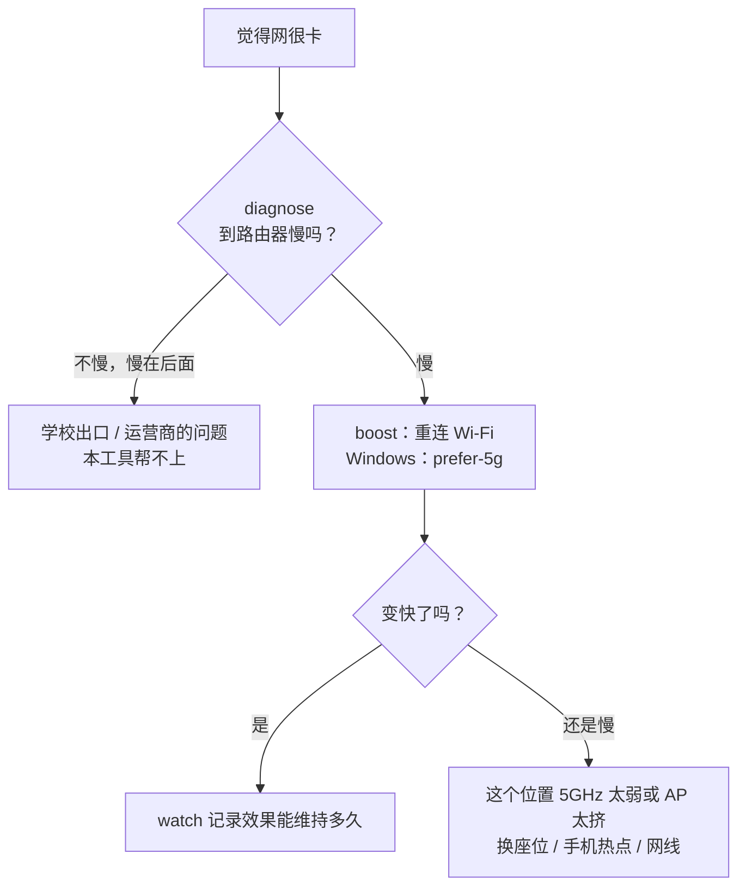

<div align="center">


# eduroam-boost

**校园 Wi-Fi 卡？先测出慢在哪，再对症处理。**

[](https://github.com/LucasYanzy/eduroam-boost/actions/workflows/test.yml)


**简体中文** | [English](README.en.md)

</div>

在 eduroam 这类大型校园网上，设备经常黏在一个拥挤或信号弱的 2.4GHz 热点上不走：**电脑到路由器这一跳**就要几百毫秒，后面的网络再快也救不回来。VPN、“游戏加速器”优化的是路由器之后的线路，对这种情况无能为力。

eduroam-boost 做三件事：

<table>
<tr>
<td width="33%" valign="top">
<br>
<b>测</b><br>
<sub>频段、信号、到路由器的延迟和丢包，判断瓶颈是 Wi-Fi 这一跳还是学校出口</sub>
</td>
<td width="33%" valign="top">
<br>
<b>治</b><br>
<sub>只在确实很慢时重连 Wi-Fi、换热点；Windows 还能让网卡长期优先 5GHz</sub>
</td>
<td width="33%" valign="top">
<br>
<b>验</b><br>
<sub>记录每次处理前后的数据，统计成功率和效果维持了多久；没用的时候也会直说</sub>
</td>
</tr>
</table>

```console
$ eduroam-boost
频段     2.4GHz   6 (2GHz, 20MHz)
信号   -73 dBm（噪声 -94 dBm）
速率     24 Mbps
到路由器 546 ms, 丢包 0%
附近 5/6GHz 同类网络: 157 (5GHz, 40MHz)

诊断: 连接差 — 到路由器平均 546ms（>100）; 连在 2.4GHz，附近有 5/6GHz 的同类网络
建议: eduroam-boost boost
```

<sub>↑ 数据来自 2026 年 11 月，一台 MacBook Pro 在某大学 eduroam 上的实测。</sub>

## 目录

- [支持的平台](#支持的平台)
- [安装](#安装)
- [使用](#使用)
- [它是怎么工作的](#它是怎么工作的)
- [实测结果](#实测结果)
- [iPhone / iPad](#iphone--ipad)
- [安卓](#安卓)
- [隐私与安全](#隐私与安全)
- [常见问题](#常见问题)
- [卸载](#卸载)
- [参与开发](#参与开发)

## 支持的平台

| 平台 | 能做什么 | 安装方式 | 状态 |
|---|---|---|---|
| **macOS** | 诊断 · 重连换热点 · 后台监控 · 效果统计 | 一行命令 |  真机使用中 |
| **Windows** | 以上全部，外加**让网卡长期优先 5GHz** | 一行命令 |  自动测试通过，尚未在真机上验证 |
| **iPhone / iPad** | 一键关开 Wi-Fi（快捷指令） | 导入快捷指令 |  尚未在真机上验证 |
| **安卓** | 系统不允许 App 开关 Wi-Fi | 手动操作 |  |

## 安装

### macOS

打开「终端」，粘贴：

```bash
curl -fsSL https://raw.githubusercontent.com/LucasYanzy/eduroam-boost/main/install.sh | bash
```

安装过程中会问你要不要开**后台监控**（登录后自动运行）：

| 选择 | 效果 |
|---|---|
| `n`（默认） | 只装命令，需要时自己运行 |
| `y` 只提醒 | 每 30 秒检查一次，连续 3 次都很慢（约 1.5 分钟）就弹系统通知 |
| `a` 自动处理 | 同上，但直接帮你重连；每次断网几秒，两次之间至少隔 5 分钟 |

想跳过提问，可以直接带参数：`… | bash -s -- --watch`、`--watch-auto` 或 `--no-watch`。

> 需要 Python 3.8+。macOS 一般自带，如果提示找不到，先运行 `xcode-select --install`。
> 不需要管理员权限，只用 Python 标准库和 macOS 自带命令。命令装在 `~/.local/bin`，安装脚本会告诉你是否需要把它加进 PATH。

### Windows（实验性）

打开 PowerShell，粘贴：

```powershell
irm https://raw.githubusercontent.com/LucasYanzy/eduroam-boost/main/windows/install.ps1 | iex
```

安装时会问两件事：要不要开后台监控（登录时自动运行），以及要不要现在就让网卡**优先连 5GHz**（会弹一次管理员确认）。装好后打开一个新的终端窗口就能用 `eduroam-boost` 了。

## 使用

| 命令 | 作用 |
|---|---|
| `eduroam-boost` | 看当前状况并给出诊断（等同于 `status`） |
| `eduroam-boost diagnose` | 20 秒对比测试：慢在 Wi-Fi 这一跳，还是学校出口 / 运营商？ |
| `eduroam-boost boost` | 重连 Wi-Fi，最多 3 次，每次都重新测量，变好就停。连接本来就不慢时不会动手（`--force` 强制，`--tries N` 改次数） |
| `eduroam-boost watch` | 前台持续监控；加 `--auto` 自动重连，`--interval 秒数` 改检查间隔 |
| `eduroam-boost report` | 最近 24 小时的统计（`--hours N` 改范围）：各频段占比、延迟、每次 boost 的前后对比，以及**效果维持了多久** |
| `eduroam-boost prefer-5g` | 仅 Windows：把网卡驱动的「首选频带」设为 5GHz，重启后也有效；`-Undo` 恢复默认 |

推荐的使用顺序：

1. 觉得卡 → 先运行 `eduroam-boost diagnose`，看是不是 Wi-Fi 的问题
2. 是 Wi-Fi 的问题 → `eduroam-boost boost`（Windows 优先用 `prefer-5g`）
3. 用了几天 → `eduroam-boost report`，看到底有没有用

输出语言跟随系统（中文或英文），可以用 `EDUROAM_BOOST_LANG=zh` 或 `=en` 强制指定。日志保存在 macOS 的 `~/Library/Logs/eduroam-boost/`、Windows 的 `%LOCALAPPDATA%\eduroam-boost\`。

## 它是怎么工作的



**为什么会这样：**一台校园 AP 通常同时发 2.4GHz 和 5GHz（新的还有 6GHz）。2.4GHz 穿墙好，但信道少、人一多就挤；5/6GHz 快得多。设备第一次连上哪个频段，往往就一直待着不换（sticky client），哪怕旁边的 5GHz 好得多。

**怎么判断：**读取系统的 Wi-Fi 信息（频段、信号、附近有没有同类型的 5/6GHz 网络），再 ping 默认网关，测出第一跳的延迟和丢包。只有**实测到的症状**（延迟 >100ms 或丢包 >10%）才算慢；单纯“连在 2.4GHz、旁边有 5GHz”只作为提示，因为弱的 5GHz 可能比还不错的 2.4GHz 更差（[实测](#实测结果)里就遇到了）。

**怎么处理：**macOS 和 iOS 都不让手动选频段或指定热点，但关掉再打开 Wi-Fi 会触发重新扫描，经常就换到了更好的热点。Windows 上，多数无线网卡驱动有「首选频带（Preferred Band）」选项，直接设成偏好 5GHz，比反复重连更彻底。

**怎么验证：**每次 boost 都会记下前后数据；后台监控持续采样，`report` 据此算出成功率、各频段的延迟，以及每次 boost 之后过了多久又变慢。

## 实测结果

2026 年 11 月，一台 MacBook Pro 在美国某大学的 eduroam 上，同一个位置：

| 时间 | 频段 / 信号 | 到路由器（平均 / 最高） | 丢包 |
|---|---|---|---|
| 13:28 | 2.4GHz 第 6 信道，-70 dBm | 72ms / 230ms | 0–10% |
| 14:05 | 2.4GHz 第 6 信道，-73 dBm | **546ms / 1544ms** | 0% |
| 14:14（boost 前） | 2.4GHz，-69 dBm | 25ms | 0% |
| boost 重连 3 次后 | 每次都还是 2.4GHz，-68 dBm | 10–43ms | 0–10% |

如实地说：

- **在这个位置 boost 没能换到 5GHz。** 附近能看到同类的 5GHz 网络，但 3 次重连 Mac 都选了 2.4GHz，说明那里的 5GHz 信号更弱，Mac 的选择是对的。
- **同一个热点，延迟一天里从 10ms 到 1.5 秒剧烈波动。** 主要是这台 AP 的拥挤程度在变，不完全是频段问题。
- **这次测试改进了工具本身。** 早期版本只要“在 2.4GHz 且旁边有 5GHz”就重连，结果白白断网 3 次，所以现在只看延迟和丢包。

后台监控的长期数据（效果能维持多久）会持续补充。也欢迎把你学校的 `eduroam-boost report` 结果[提交到 Issues](https://github.com/LucasYanzy/eduroam-boost/issues)。

## iPhone / iPad

iOS 不允许任何 App 选择频段或读取热点详情，所以手机上能做的只有一件事：一键关开 Wi-Fi，让手机重新选热点。

1. 用 iPhone 的 Safari 打开 **[eduroam-Boost.shortcut](https://github.com/LucasYanzy/eduroam-boost/raw/main/ios/eduroam-Boost.shortcut)**，下载后选择用「快捷指令」打开，点「添加快捷指令」。
2. 觉得卡的时候运行它：关闭 Wi-Fi → 等 3 秒 → 打开 → 弹出通知。

建议设成双击手机背面触发：「设置 → 辅助功能 → 触控 → 轻点背面 → 轻点两下」，选「eduroam Boost」。也可以加到主屏幕或控制中心。

**导入不了？** 自己建一个只要一分钟：新建快捷指令 → 添加「设定 Wi-Fi」设为**关** → 添加「等待」3 秒 → 再添加「设定 Wi-Fi」设为**开**。

> Mac 和 iPhone 登录同一个 Apple ID、并在 iCloud 里开启了「快捷指令」的话，在 Mac 上添加后会自动同步到手机。

## 安卓

安卓 10 以后，普通 App 既不能开关 Wi-Fi，也不能指定连哪个热点，所以做不成一键工具。可以手动这样做：

- **关开 Wi-Fi**：下拉控制中心，把 WLAN 关掉再打开，效果和 iPhone 快捷指令一样。
- **优先 5GHz**：部分手机（如三星、小米）在「WLAN → 高级设置」里有频段选择或“优先 5GHz”，打开即可。
- **用 ADB**（适合开发者）：
  ```bash
  adb shell cmd wifi set-wifi-enabled disabled && sleep 3 && adb shell cmd wifi set-wifi-enabled enabled
  ```

## 隐私与安全

- **不收集、不上传任何数据。** 所有记录只保存在你自己的电脑上。
- **只发出很少的网络请求**：ping 你的默认网关；`diagnose` 额外 ping 一次 `1.1.1.1`。
- **不需要热点名称。** macOS 不给定位权限时会隐藏热点名，本工具也用不到它。
- **不改系统的网络配置。** macOS 上只会关开 Wi-Fi；Windows 上只有你主动运行 `prefer-5g` 时才会改网卡的「首选频带」，`-Undo` 可以恢复。
- **代码很短**，主程序只有一个 Python 文件和一个 PowerShell 文件，安装前可以先读一遍。

## 常见问题

<details>
<summary><b>重连会打断正在进行的下载、视频会议吗？</b></summary>

会，Wi-Fi 会断开几秒。所以 boost 只在确实很慢时才动手；后台监控默认只提醒，不会自动重连。
</details>

<details>
<summary><b>boost 试了 3 次还是 2.4GHz，是坏了吗？</b></summary>

不是。说明你这个位置的 5GHz 信号比 2.4GHz 更弱，设备选得没错。这种情况下软件能做的已经到头了：换个离 AP 近的座位、用手机热点，或者插网线。
</details>

<details>
<summary><b>diagnose 说慢在学校出口，怎么办？</b></summary>

那就不是你的设备或 Wi-Fi 的问题，任何装在电脑上的工具都帮不上，只能等高峰期过去，或者换个网络。
</details>

<details>
<summary><b>为什么不直接指定连哪个 BSSID（具体某个热点）？</b></summary>

macOS 和 iOS 不允许命令行工具这么做（需要定位权限和私有接口）。本工具只用系统公开、稳定的功能，升级系统也不容易坏。
</details>

<details>
<summary><b>不在 eduroam 上能用吗？</b></summary>

能。它适用于任何同时提供 2.4GHz 和 5/6GHz 的 Wi-Fi，校园网、公司网都可以。
</details>

## 卸载

macOS（加 `-s -- --purge` 连日志一起删）：

```bash
curl -fsSL https://raw.githubusercontent.com/LucasYanzy/eduroam-boost/main/uninstall.sh | bash
```

Windows（如果用过 `prefer-5g`，先运行 `eduroam-boost prefer-5g -Undo` 恢复网卡设置）：

```powershell
irm https://raw.githubusercontent.com/LucasYanzy/eduroam-boost/main/windows/uninstall.ps1 | iex
```

## 参与开发

```
eduroam_boost.py        macOS 命令行工具（只用标准库）
install.sh / uninstall.sh
windows/                PowerShell 版、安装/卸载脚本、Pester 测试
ios/                    iPhone 快捷指令及其生成脚本
tests/                  macOS 单元测试和安装测试
```

```bash
python3 -m unittest discover -s tests -v                  # macOS：单元测试 + 安装/卸载测试（都在临时目录里进行）
pwsh -c "Invoke-Pester windows/tests -Output Detailed"    # Windows：解析逻辑测试
python3 ios/build_shortcut.py                             # 重新生成并签名快捷指令（需要 macOS）
```

每次提交，CI 都会在 macOS、Windows 和 Linux（shellcheck）上跑一遍。特别欢迎这几类贡献：

- **Windows 真机测试结果**，尤其是 `prefer-5g` 在不同网卡上的表现
- **非英文 Windows 的 `netsh` 输出样例**，放到 `windows/tests/fixtures/`
- **你学校的实测数据**（`eduroam-boost report` 的输出）

## License

[MIT](LICENSE)
